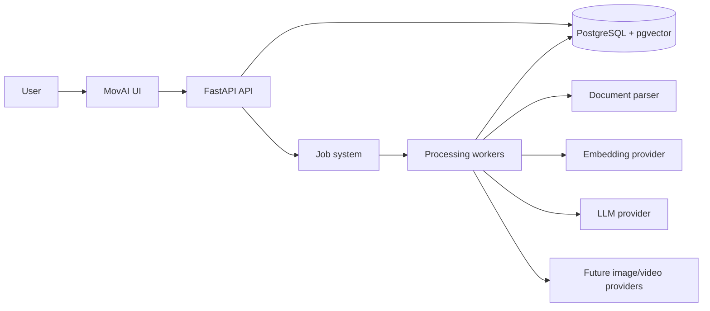
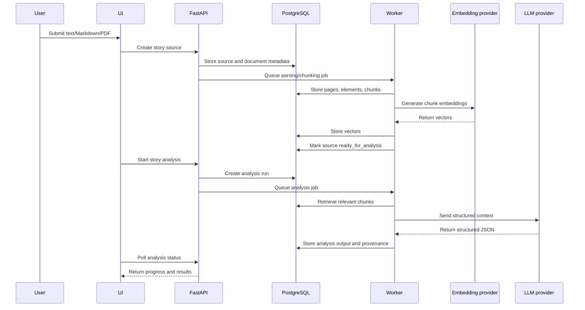
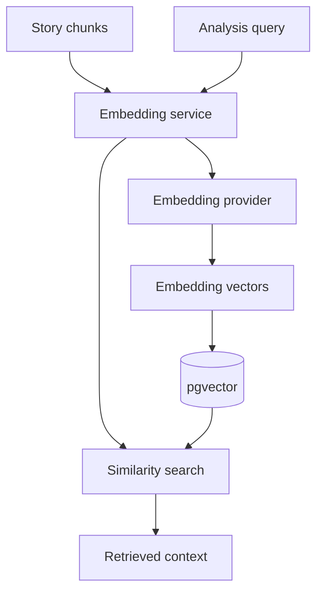
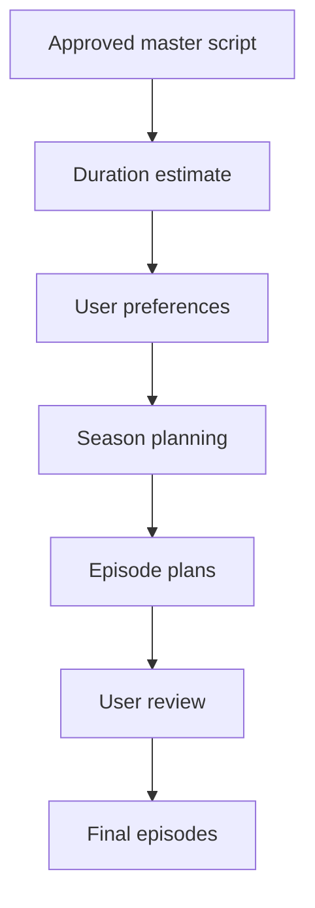

# MovAI — High-Level Design

Version: 0.1  
Scope: Story ingestion, analysis, continuity management, season/episode planning, and future media generation.

## 1. Product objective

MovAI transforms a complete story into structured, production-ready narrative data.

```text
Complete story
  → Structured story model
  → Master script
  → Seasons
  → Episodes
  → Characters and continuity assets
  → Storyboards
  → Future image/video generation
```

## 2. Product hierarchy

```text
Project
└── Series
    ├── Story source
    ├── Master script
    ├── Characters
    ├── Costumes and possessions
    ├── Continuity rules
    └── Seasons
        └── Episodes
            ├── Scenes
            └── Storyboards
```

Characters and series-level continuity belong to the series. Usage and state changes are mapped to seasons, episodes, and scenes.

## 3. System context



## 4. Major components

### Frontend

Current frontend is served by FastAPI under `/ui/`.

Responsibilities:

- Project and series navigation
- Story submission
- Upload status
- Analysis progress
- Season planning
- Episode-plan review
- Character/continuity review
- Future media-generation controls

### API layer

FastAPI exposes versioned endpoints under `/api/v1`.

Responsibilities:

- Request validation
- Ownership checks
- Job creation
- Read-model responses
- Workflow commands

The API should remain responsive and should not perform long-running LLM, embedding, or media operations directly.

### Application services

Services coordinate use cases:

- Catalog service
- Story ingestion service
- Embedding service
- Story analysis service
- Continuity service
- Season planning service
- Episode planning service
- Job service

### Repositories

Repositories own SQL and database persistence:

- Catalog repository
- Story repository
- Embedding repository
- Analysis repository
- Continuity repository
- Season repository
- Episode repository
- Job repository

### Workers

Workers run long-running operations:

- Document ingestion worker
- Embedding worker
- Complexity-analysis worker
- Entity-extraction worker
- Timeline-analysis worker
- Master-script worker
- Episode-planning worker
- Media-generation worker

### Providers

Providers isolate external models and services:

- Document parser provider
- Embedding provider
- LLM provider
- Image provider
- Video provider

## 5. End-to-end story flow



## 6. Story-processing pipeline

```text
Input validation
  ↓
Document parsing
  ↓
Normalization
  ↓
Page/section preservation
  ↓
Chunking
  ↓
Embedding generation
  ↓
Similarity retrieval
  ↓
Complexity analysis
  ↓
LLM entity extraction
  ↓
Entity resolution
  ↓
Timeline and causal analysis
  ↓
Continuity analysis
  ↓
Master-script generation
  ↓
Duration estimation
```

## 7. Input support

Supported input types:

- Pasted text
- Markdown files
- Text-based novel PDFs

Scanned PDFs are rejected. OCR is outside the current product scope.

Each source is assigned:

- Source ID
- File hash
- Parser metadata
- Page count
- Extraction status
- Source format

## 8. Data architecture

### Core catalog

```text
projects → series → seasons → episodes
```

### Source and document data

```text
story_sources
  → source_documents
  → document_pages
  → document_elements
  → story_chunks
  → story_embeddings
```

### Analysis data

```text
analysis_runs
  → analysis_run_stages
  → analysis_outputs
```

### Continuity data

```text
characters
character_versions
costumes
continuity_objects
story_events
timeline_anchors
character_states
artifact_states
continuity_assignments
continuity_conflicts
```

### Production data

```text
episode_plans
scenes
storyboard_frames
generation_jobs
approvals
```

## 9. Embedding architecture



The active local model is:

```text
sentence-transformers/all-MiniLM-L6-v2
384 dimensions
```

Vectors are isolated by model and version. Old vectors become obsolete during re-embedding.

## 10. LLM architecture

The LLM is accessed through a provider interface:

```text
StoryAnalysisService
  → LLMProvider
      ├── MockLLMProvider
      ├── LocalLLMProvider
      └── HostedLLMProvider
```

The LLM receives:

- Analysis task
- Complexity profile
- Retrieved story chunks
- Timeline context
- Known entities
- Required output schema

The LLM does not receive raw embeddings. It receives source text selected through retrieval.

## 11. Analysis stages

```text
Stage 1: Validate source
Stage 2: Parse document
Stage 3: Create chunks
Stage 4: Generate embeddings
Stage 5: Analyze complexity
Stage 6: Extract entities
Stage 7: Resolve entities and aliases
Stage 8: Build timeline
Stage 9: Build continuity states
Stage 10: Generate master script
Stage 11: Estimate duration
Stage 12: Plan seasons
Stage 13: Plan episodes
```

Each stage produces:

- Status
- Progress
- Output metadata
- Error metadata
- Source references
- Timestamps

## 12. Season and episode planning



The first season is created through series-level planning. Additional seasons can be created after the relevant story state is complete.

Episodes are generated by segmentation and are not manually created.

## 13. Continuity architecture

Continuity is tracked at multiple levels:

```text
Series-level identity
  → Season-level usage
  → Episode-level appearance
  → Scene-level state
```

Tracked objects include:

- Character identity and versions
- Face/body design
- Costumes
- Accessories
- Possessions
- Locations
- Injuries and physical state
- Knowledge state
- Relationship state
- Timeline/world membership

## 14. Job architecture

```text
Queued
  → Running
  → Succeeded
```

Failure path:

```text
Running
  → Failed
  → Retry queued
  → Failed permanently
```

Job metadata includes:

- Provider
- Provider model
- Request metadata
- Progress
- Retry count
- Error summary
- Estimated/actual cost
- Output references

Current development jobs include:

- `embedding_generation`
- `story_analysis`
- `episode_segmentation`
- `storyboard_generation`

## 15. Deployment view

### Current single-machine development

```text
Windows machine
├── FastAPI/Uvicorn
├── Static UI
├── PostgreSQL 13
├── pgvector
└── Local embedding model
```

### Future production deployment

```text
Browser
  ↓
Frontend hosting/CDN
  ↓
API service
  ├── PostgreSQL + pgvector
  ├── Object storage
  ├── Job queue
  └── Worker fleet
       ├── Parsing workers
       ├── Embedding workers
       ├── LLM workers
       └── Media workers
```

## 16. Security boundary

Authentication is deferred for the current single-user development phase.

Future production requirements:

- User authentication
- Project-level authorization
- Signed upload URLs
- Secret management
- Provider key isolation
- Rate limiting
- File scanning
- Audit logging

## 17. Current state

Completed:

- Modular FastAPI routing
- PostgreSQL and pgvector schema
- Text/Markdown/PDF ingestion
- OCR rejection
- Page-aware chunking
- Local embeddings
- Model-aware retrieval
- Complexity analysis
- Job and analysis-stage tracking
- Structured LLM provider contract
- Mock entity-extraction stage

Pending:

- Real LLM provider
- Entity resolution
- Timeline and causal analysis
- Continuity extraction
- Master-script generation
- Duration estimation from generated story structure
- AI season and episode segmentation
- Production worker queue

## 18. Immediate next milestone

Connect one real structured-output LLM provider behind the existing `LLMProvider` interface, then persist validated entity extraction into the character, location, object, and event domain tables.

