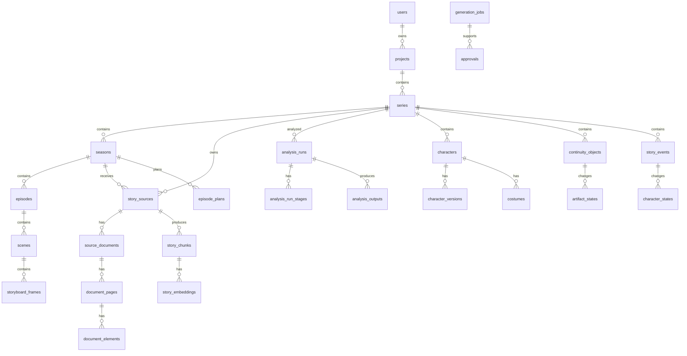

# MovAI Database ERD

## Main ownership rules

- Projects belong to users.
- Series belong to projects.
- Characters and continuity objects belong to series.
- Seasons belong to series.
- Episodes belong to seasons and series.
- Sources may belong directly to a series or to a season.
- Analysis runs belong to a series and source.

## Important polymorphic relationships

`continuity_assignments` maps characters, costumes, and continuity objects to seasons, episodes, scenes, and story units using `entity_type` and `entity_id`.

`analysis_outputs` stores versioned JSON payloads with source references for auditability.
